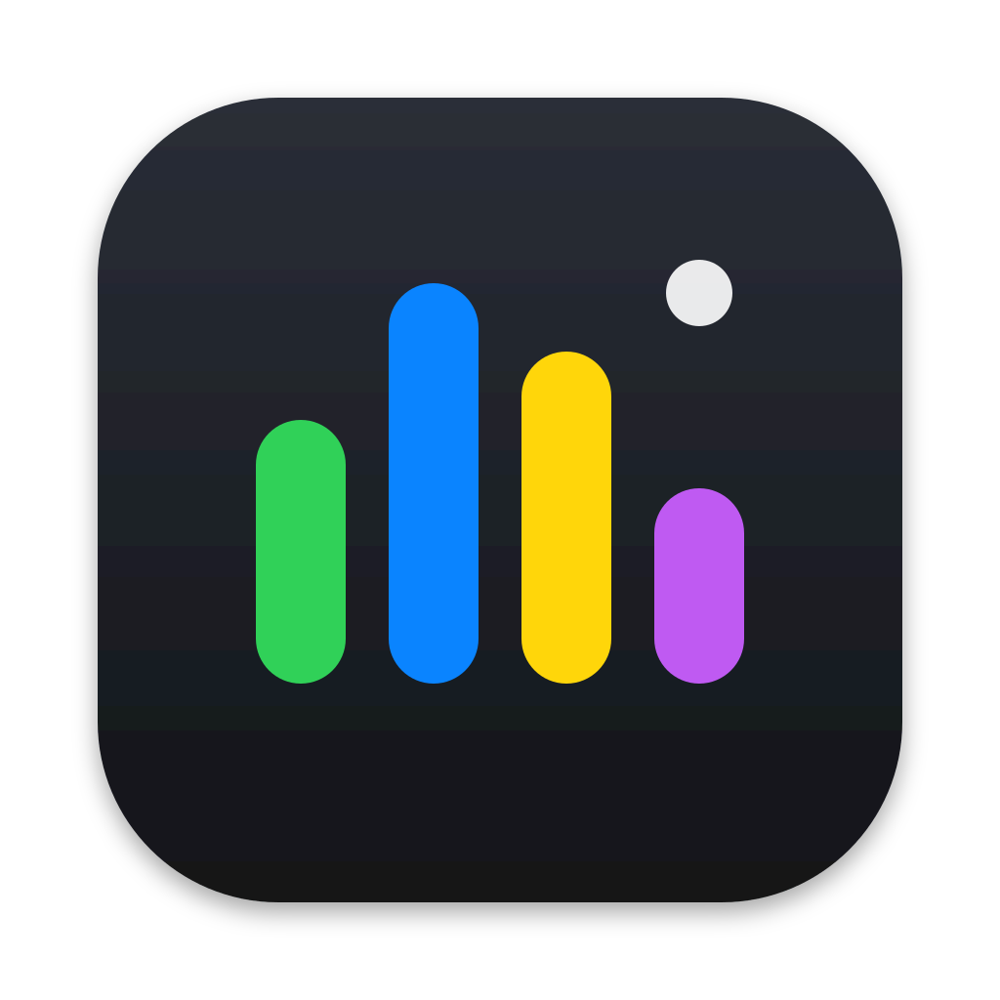
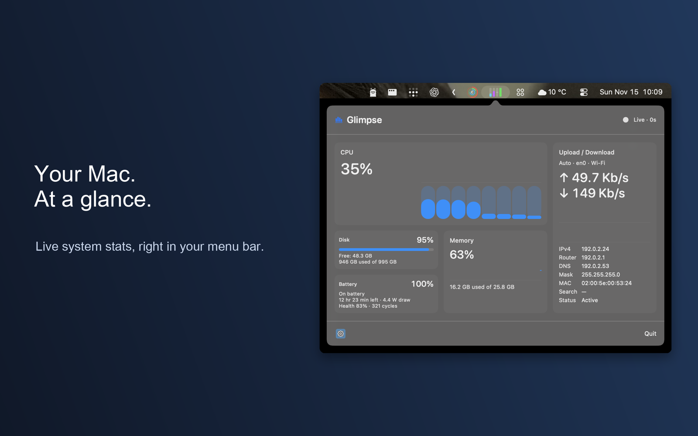
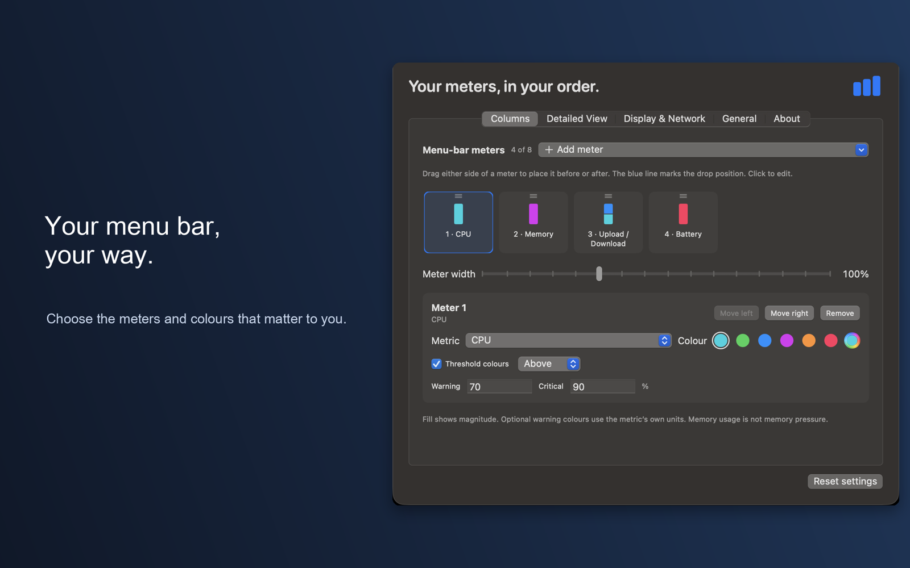
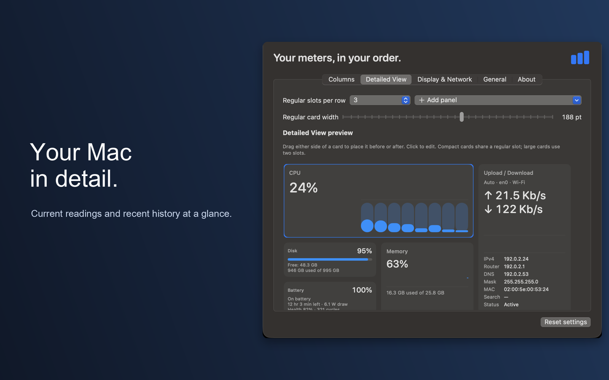

<p align="center">
  
</p>

<h1 align="center">Glimpse</h1>

<p align="center">
  <b>Your Mac's vital signs in one small menu-bar icon.</b><br>
  CPU, memory, network, battery, disk and thermal state: at a glance, free and open source.
</p>

<p align="center">
  <a href="https://github.com/nairdaleo/Glimpse/releases/latest"></a>
  
  
  <a href="LICENSE"></a>
</p>

<p align="center">
  <a href="https://github.com/nairdaleo/Glimpse/releases/latest"><b>Download</b></a> ·
  <a href="#install">Homebrew</a> ·
  <a href="https://tastyjam.ca/glimpse/">Website</a>
</p>

<p align="center">
  
</p>

## Why Glimpse

- **One compact icon.** One to eight thin meters live in a single menu-bar item. They fill and change colour as your Mac works.
- **Click for detail.** A panel you arrange yourself shows exact readings and short histories for CPU, memory, network, battery, disk and thermal state.
- **Yours to arrange.** Choose each meter's metric, order, width and colour, with optional warning and critical thresholds.
- **Every network interface.** Upload and download per interface (Wi-Fi, Ethernet and more), side by side or on Auto. They are never added together.
- **Light and native.** Reads the system's own counters, with no subprocess polling, and pauses while your Mac sleeps. Measured numbers are in [docs/performance.md](docs/performance.md).
- **Private.** No account, no analytics, no network requests. Settings and readings stay on your Mac.
- **Free.** Every feature is free. The Mac App Store edition has optional tips that unlock nothing.

<table>
  <tr>
    <td width="50%"></td>
    <td width="50%"></td>
  </tr>
  <tr>
    <td align="center"><sub>Pick meters, order, colours and thresholds</sub></td>
    <td align="center"><sub>Arrange the detailed panel's cards</sub></td>
  </tr>
</table>

## Install

- **Download:** [tastyjam.ca/glimpse](https://tastyjam.ca/glimpse/) or the [latest GitHub release](https://github.com/nairdaleo/Glimpse/releases/latest). Use the notarized universal DMG for Apple silicon and Intel, macOS 12 or later.
- **Homebrew:**
  ```bash
  brew trust --cask nairdaleo/tastyjam/glimpse   # current Homebrew asks you to trust casks from third-party taps
  brew install --cask nairdaleo/tastyjam/glimpse
  ```
- **Mac App Store:** in review.

## Using it

Click the icon for live status and recent graphs; the gear button opens Settings. In **Columns**, add, drag and remove meters and set their width. The **Upload / Download** meter fills upward from its centre for upload and downward for download, in separate colours, and an optional numeric readout keeps exact speeds visible. In **Detailed View**, add panels with **+ Add panel**, choose 1–8 per row and their width, and set each card's metric, size, colour and history. Clicking a card in the dropdown opens its settings. **Display & Network** lists each interface's type, local addresses and DNS configuration. **General** has opt-in start at login, a show/hide shortcut, the refresh rate and, in the direct download, automatic updates.

## Compatibility

The deployment target is **macOS 12 Monterey**, with a universal Intel and Apple silicon build. Native-reader tests run on the current Apple silicon development Mac. The owner tested the app on an Intel Mac running macOS 12.7.6, including start at login across a restart and a log out and back in. macOS 12 is the oldest deployment target supported by the currently selected Xcode 27.2 toolchain. Going lower remains a tracked investigation.

The menu-bar renderer will use AppKit. Settings may use SwiftUI APIs available on macOS 12. Newer convenience APIs must not raise the minimum version without a documented reason.

## Documentation and development

- [Public project board](https://github.com/users/nairdaleo/projects/10): upcoming work and validation.
- [Architecture](docs/architecture.md): modules, data flow, threading, editions and the build/release pipeline.
- [Contributing](CONTRIBUTING.md): how to propose changes, and the AI guidelines.
- [AGENTS.md](AGENTS.md): the shared rules for AI coding agents working on Glimpse.
- [Design](docs/design.md): user experience, sampling, compatibility, performance goals, and validation.
- [iGlance assessment](docs/iglance-assessment.md): what we studied and what remains unverified.
- [License decision](docs/licensing.md): why MIT was selected and how third-party code is handled.
- [Development and validation](docs/development.md): build, run, test, metric definitions, and remaining checks.
- [Updates and login](docs/updates.md): signed update configuration, login helper and free Mac App Store roadmap.
- [Releasing](docs/releasing.md): CI, and the local release script for GitHub Releases, Sparkle, Homebrew and the App Store.
- [Performance](docs/performance.md): measured idle CPU and memory against the budgets, and how to measure.

With Xcode 27.2 selected, build and open the app:

```bash
./scripts/build-app.sh
open build/Glimpse.app
```

Click the icon for detailed live status. The gear button opens settings for meters, dropdown panels, colours, warning thresholds, units, interface, refresh cadence, login and updates. Reopening the app opens settings if the icon is hidden by menu-bar crowding.

```bash
swift test
ARCH=universal ./scripts/build-app.sh
build/Glimpse.app/Contents/MacOS/Glimpse --diagnose
```

Sparkle 2.10.1 is the sole external dependency, pinned by SwiftPM for signed direct-download updates. The build script defaults to an ad-hoc signature; set `CODESIGN_IDENTITY` to a certificate identity for development signing. Distribution requires Developer ID signing and notarization. Do not disable Gatekeeper to run a downloaded build.

Glimpse's monitoring features will remain fully free. The separate Mac App Store edition is sandboxed, has no Sparkle, and offers optional tips and a review prompt; neither unlocks features. See [docs/updates.md](docs/updates.md).

Contributions are welcome through issues and pull requests; see [CONTRIBUTING.md](CONTRIBUTING.md).

## Inspiration and license

Inspired by the glanceable monitoring of MenuMeters and iGlance, and by the compact footprint of Tailscale's menu-bar icon. This is an independent project; no upstream app code or branding has been imported.

Copyright (c) 2026 Tasty Jam App Development. Released under the [MIT License](LICENSE). Third-party components, if introduced, retain their own licenses and notices.
